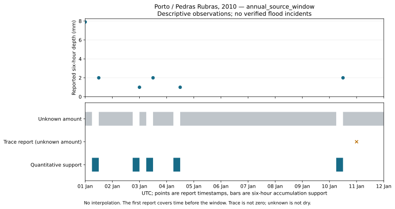

# Porto historical rainfall case study

**Descriptive only: no verified flood incident, prediction accuracy or warning lead time is established.**

Station `POMU0068545`, report-time window `[2010-01-01T00:00:00+00:00, 2010-01-12T00:00:00+00:00)`; scope **annual_source_window**.

The real repository inserted 6 observations; a replay inserted 0 and verified 6 existing rows. Analytics use the committed database readback. Both import audits and original lineage were verified.

Interval analysis classified 6 positive-depth reports and 0 observed-zero reports. Maximum reported six-hour depth: 7.9 mm. These totals do not locate rainfall within each six-hour interval.

Source timestamp states: `{'missing_rainfall': 522, 'observed_positive': 6, 'observed_zero': 0, 'trace_rainfall': 1}`.

Clipped quantitative support: 30 / 264 hours (11.36%). Unknown intervals are not dry. This excludes accumulations reported at/after the right edge; the first report ends at the left edge and supplies no in-window support.

The operational 15-minute detector was not run on six-hour totals. Interval classification uses the explicit depth > 0 mm rule, not a calibrated flood-alert threshold. No independent labels or reviewed negative periods exist here: precision, recall, false-alarm rate and lead time remain null.

## Observation and incident-review timeline

These are rainfall observations and unknown periods for incident review, not confirmed flood incidents. The trace entry has unknown amount. All numeric values retain unverified source QC.

| Start UTC | End UTC | Evidence | Depth (mm) |
| --- | --- | --- | ---: |
| 2009-12-31T18:00:00+00:00 | 2010-01-01T00:00:00+00:00 | reported_wet_interval | 7.9 |
| 2010-01-01T00:00:00+00:00 | 2010-01-01T06:00:00+00:00 | unknown_amount_interval | unknown |
| 2010-01-01T06:00:00+00:00 | 2010-01-01T12:00:00+00:00 | reported_wet_interval | 2.0 |
| 2010-01-01T12:00:00+00:00 | 2010-01-02T18:00:00+00:00 | unknown_amount_interval | unknown |
| 2010-01-02T18:00:00+00:00 | 2010-01-03T00:00:00+00:00 | reported_wet_interval | 1.0 |
| 2010-01-03T00:00:00+00:00 | 2010-01-03T06:00:00+00:00 | unknown_amount_interval | unknown |
| 2010-01-03T06:00:00+00:00 | 2010-01-03T12:00:00+00:00 | reported_wet_interval | 2.0 |
| 2010-01-03T12:00:00+00:00 | 2010-01-04T06:00:00+00:00 | unknown_amount_interval | unknown |
| 2010-01-04T06:00:00+00:00 | 2010-01-04T12:00:00+00:00 | reported_wet_interval | 1.0 |
| 2010-01-04T12:00:00+00:00 | 2010-01-10T06:00:00+00:00 | unknown_amount_interval | unknown |
| 2010-01-10T06:00:00+00:00 | 2010-01-10T12:00:00+00:00 | reported_wet_interval | 2.0 |
| 2010-01-10T12:00:00+00:00 | 2010-01-12T00:00:00+00:00 | unknown_amount_interval | unknown |
| 2010-01-11T00:00:00+00:00 | 2010-01-11T00:00:00+00:00 | source_trace_report | unknown |

See [observations.csv](observations.csv), [daily.csv](daily.csv), [timeline.csv](timeline.csv), [quality.json](quality.json), [case-study.json](case-study.json) and [manifest.json](manifest.json) for exact counts, provenance, configuration and artifact hashes.

Source: Menne et al., NOAA NCEI GHCNh, [DOI 10.25921/jp3d-3v19](https://doi.org/10.25921/jp3d-3v19), CC0-1.0. No NOAA endorsement.
