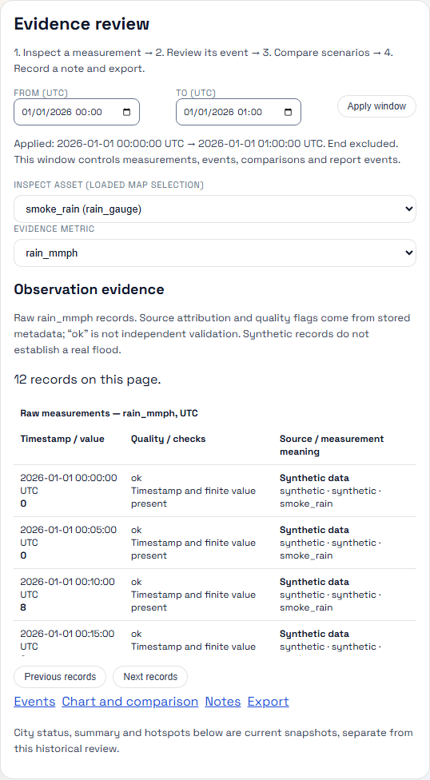
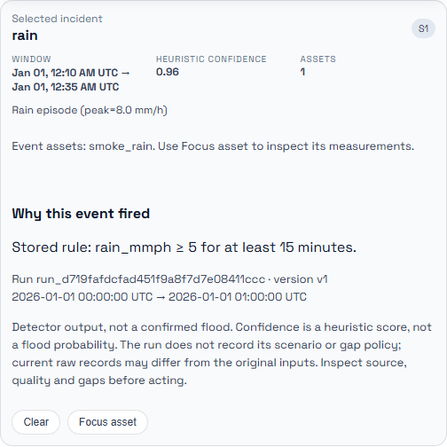
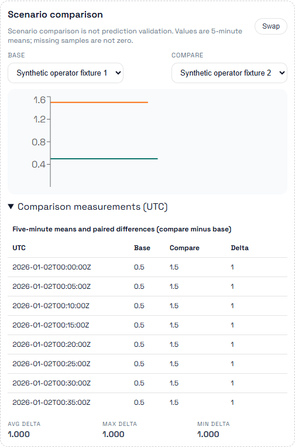

# Demonstration screenshots

## Operator workflow — 2026-11-02

These three screenshots were captured by `operator_live.spec.ts` from the
functioning React application, real API, disposable PostgreSQL database and
worker at implementation commit `58a9d2b19df5fa526e65d55b61b2fef3c45ac916`.
Project: `city-flood-smoke-a58284aee8eb`; all inputs are synthetic fixtures.
The run passed and cleaned up its resources. See the
[workflow and verification record](../ui-workflows.md#observed-local-verification--2026-11-02).

The tables scroll; the comparison's final missing sample is asserted by the
browser test and is below the screenshot's visible rows. These images demonstrate
the interface, not prediction skill or a real flood. The later empty-filter
selection fix has its own browser regression and does not change this captured path.

## Earlier screenshots (01–04)

The earlier images predate the operator workflow. Their original capture checklist
is retained below; they are not evidence for the new tests.

Capture these after running `./scripts/seed_all.sh`:

1) Web UI map with layers toggled on (river + pipes + gauges).
2) Hotspot list + selected asset detail with telemetry chart.
3) Events card showing recent events.
4) Grafana dashboard (API latency + DB query panels).

Place image files in this folder and reference them in `docs/demo.md` if needed.
